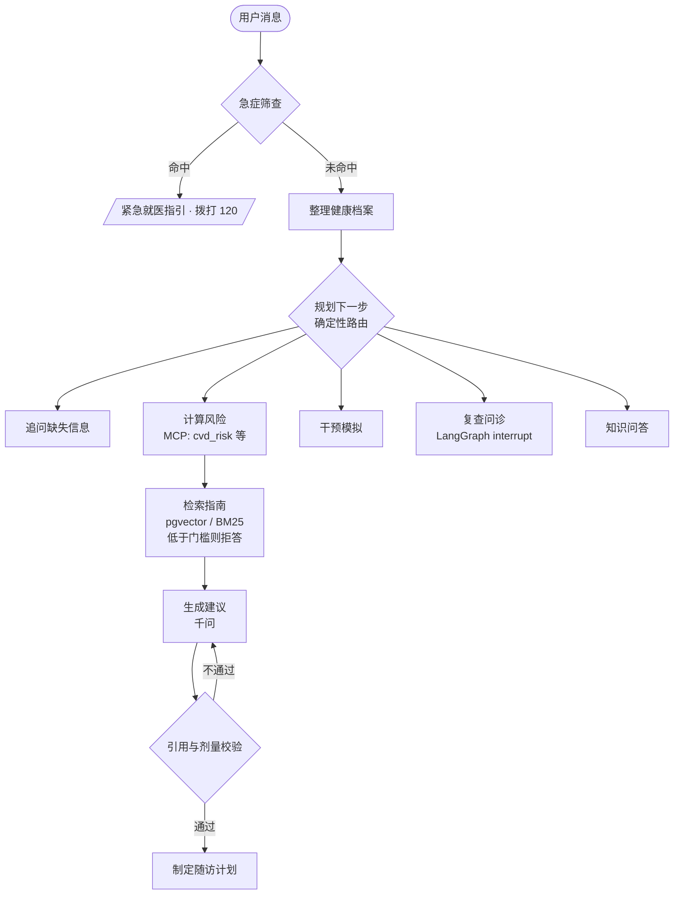

<div align="center">


# HealthPilot

**会追问、会算风险、只按指南说话的心血管健康 Agent**

用中文描述健康情况，它会追问缺失的信息，计算 10 年心血管病风险，<br>
再根据指南给出带引用的生活方式建议，并在之后的复查中追踪风险变化。

[](https://github.com/NewUranus/health-agent/actions/workflows/ci.yml)


[在线演示](https://47-250-192-131.sslip.io) · [30 秒跑起来](#30-秒跑起来) · [架构](#架构) · [评测](#评测) · [接口与运维文档](docs/PLATFORM.md)


</div>

> [!WARNING]
> 这是技术演示，没有经过医学人员审核，不构成医疗建议。在线演示请只填写虚拟数据；出现急症请立即拨打 120。

## 它和普通健康聊天机器人有什么不同

| 设计 | 说明 |
|---|---|
| 🧮 **医疗判断不交给模型** | 急症识别、流程路由、风险计算、引用校验都是确定性代码。模型只负责抽取信息、撰写建议和回答问题。 |
| 🚫 **没有依据就拒答** | 检索低于相关性门槛时直接拒答；生成后检查引用是否有效、是否出现药物剂量，不通过就重试，仍不通过就拒答。 |
| 🚨 **急症优先** | 每条消息先过急症筛查，胸痛、呼吸困难、卒中症状命中后立即给出拨打 120 的指引，复查问诊中途也一样。 |
| 🎚️ **可以推演"如果……会怎样"** | 拖动血压、胆固醇滑块或勾选戒烟，实时看风险变化，并显示 5 年、10 年后的风险。纯公式计算，不调用模型，也不改档案。 |
| 📈 **会随访** | 评估后记下复查日期；复查时多轮询问血压、依从、吸烟和症状，再和历次风险对比画成曲线。 |
| 🔍 **每一步都看得见** | 右侧实时显示每个节点、MCP 工具调用、检索到的指南原文和耗时。 |

## 截图

<table>
  <tr>
    <td colspan="3"><p align="center"><sub>评估结果（左）和 Agent 执行轨迹（右）：风险由 MCP 工具计算，建议附指南引用</sub></p></td>
  </tr>
  <tr>
    <td width="33%"><p align="center"><sub>检索到的指南依据、引用校验结果</sub></p></td>
    <td width="33%"><p align="center"><sub>干预模拟：降压、降脂、戒烟后的风险</sub></p></td>
    <td width="33%"><p align="center"><sub>随访记录：历次复查的风险曲线</sub></p></td>
  </tr>
  <tr>
    <td colspan="3"><p align="center"><sub>急症护栏：命中急症信号后跳过评估，直接给出就医指引</sub></p></td>
  </tr>
  <tr>
    <td colspan="3"><p align="center"><sub>知识库后台：上传指南 PDF、人工核对后发布，可用与问答相同的逻辑试搜</sub></p></td>
  </tr>
</table>

<sub>截图来自本地 Mock 模式（模板回复，不调用模型），数据均为虚拟。</sub>

## 30 秒跑起来

需要 Python 3.12+ 和 [uv](https://docs.astral.sh/uv/)。Mock 模式不需要任何 API Key：

```bash
uv sync
HEALTH_AGENT_MOCK=1 uv run uvicorn app.main:app --port 8000
```

打开 http://localhost:8000 ，点下方的示例按钮就能走完整流程。

- **接真实模型**：在 `.env` 里配置千问的 OpenAI 兼容接口，真实模式默认要求登录，步骤见 [运行说明](docs/PLATFORM.md#运行)
- **Docker 部署**（Postgres、HTTPS、访问口令）：见 [docs/DEPLOY.md](docs/DEPLOY.md)

## 架构



| 部分 | 技术 |
|---|---|
| Agent 编排 | LangGraph（主图 + 子图、checkpointer、Store） |
| 工具 | MCP Python SDK 2.x（stdio 子进程），Function Calling 循环 |
| 模型 | 千问（OpenAI 兼容接口，通过 langchain-openai 调用） |
| 检索 | 千问 embedding + pgvector，向量不可用时退回 BM25（rank-bm25 + jieba） |
| 后端 | Python 3.12、FastAPI、SSE 流式接口 |
| 前端 | React + TypeScript + Vite，Vitest 测试 |
| 存储 | PostgreSQL + pgvector（会话、长期记忆、知识库），未配置时用内存 |
| 部署 | Docker Compose、Caddy（HTTPS），GitHub Actions 跑测试和 Mock 评测 |

<details>
<summary>目录结构</summary>

| 目录 | 内容 |
|---|---|
| `app/` | FastAPI 接口、状态图、检索、校验、记忆 |
| `mcp_server/` | MCP 工具服务（stdio） |
| `corpus/` | 16 段指南摘要 |
| `frontend/` | 前端源码（React + TypeScript） |
| `web/` | 前端构建结果，由 FastAPI 托管 |
| `eval/` | 评测脚本和用例 |
| `ops/` | 监控、告警、备份和发布脚本 |
| `docs/` | 设计文档、部署与接口说明 |

改前端时在 `frontend/` 下运行 `npm run dev`；改完运行 `npm run build`，并把 `web/` 一起提交。

</details>

## 不只是 Demo：平台能力

账号与数据隔离、持久化任务与幂等、知识发布的人工确认、知识权限与撤回、模型网关与用量统计、多会话工作台、运行状态面板、集中日志与链路检索。

接口、配置项和各阶段的实现说明见 **[docs/PLATFORM.md](docs/PLATFORM.md)**，51 个检查项及验收进度见 [验收矩阵](ACCEPTANCE_MATRIX.md)。

## 评测

```bash
uv run pytest -q
uv run python -m eval.run_eval --mock
cd frontend && npm ci && npm test
```

2026-10-30 用 `qwen3.6-plus` 跑了一次真实模型评测：26 条用例全部通过，每轮响应 p50 约 3.7 秒、p95 约 5.2 秒。

这个结果的参考价值有限：用例是开发时自己写的，数量很少；"医学事实性"一项只检查引用是否有效，不检查内容是否正确。

### 检索选型

`eval/run_rag_eval.py` 用 50 道题对比三种检索（语料 16 段，题目是自己写的）：

| 方案 | 首条命中 | 前 3 条命中 |
|---|---|---|
| BM25 | 76.3% | 92.1% |
| BM25 + 向量（RRF 融合） | 84.2% | 94.7% |
| 向量 | 100% | 100% |

所以选了纯向量。语料小、主题差别大，这个 100% 不代表真实效果。

相关性门槛（余弦相似度 0.44）在这批题上调出来，再用没参与调参的 35 道新题（`eval/rag_holdout.jsonl`）验证：21 道可答题中 19 道首条正确且未被误拦；14 道语料答不了的题挡住 10 道。漏过的 4 道都是话题相近但人群不同（如孕妇、透析），要靠提示词让模型说明资料未覆盖，抽查的几道都做到了，但没有做系统统计。

## 已知限制

- **风险模型**：Framingham 基于美国人群，可能高估中国人群风险，国内更适合用 China-PAR。这里还没有实现
- **语料**：内置的只有 16 段摘要，按公开指南要点撰写，没有逐条对照原文，也没有文献和药品说明书
- **幻觉**：校验只查引用是否有效，不查内容是否被资料支持。抽查发现模型拒答时可能补充资料之外的知识
- **PDF 解析**：不支持扫描版；表格解析没有专门处理，发布前要人工核对
- **急症识别**：只靠关键词规则，换种说法可能识别不出来
- **随访**：提醒只在用户打开页面时出现，没有短信或微信推送，也没有医生审核；用药和症状的判断是简单的关键词规则
- **部署**：运行在一台 1G 内存的海外轻量服务器上，用的是临时域名（sslip.io），从中国内地访问的速度和稳定性没有系统测过
- **规模**：只做过单人使用，没有压测。不配置 `DATABASE_URL` 时记忆存在内存里，重启就丢
- **安全**：本地实现了账号、可撤销会话、用户隔离及基础审计，尚无组织、SSO、多角色、完整加密治理或防篡改审计。Mock 免登录模式没有个人数据访问保护，仅用于虚拟数据。代码未部署到在线演示，不能据此判断远端已经启用登录。
- **许可证**：PyMuPDF 是 AGPL，闭源商用需要换库或购买授权

## 更多文档

| 文档 | 内容 |
|---|---|
| [docs/PLATFORM.md](docs/PLATFORM.md) | 运行配置、HTTP API、各阶段平台能力 |
| [docs/DESIGN.md](docs/DESIGN.md) · [DESIGN_V2.md](docs/DESIGN_V2.md) | 设计文档 |
| [docs/DEPLOY.md](docs/DEPLOY.md) | Docker 部署 |
| [docs/ADMIN.md](docs/ADMIN.md) | 知识库后台 |
| [docs/FOLLOWUP.md](docs/FOLLOWUP.md) | 随访流程 |
| [ops/README.md](ops/README.md) | 监控、日志、备份与发布 |
| [ACCEPTANCE_MATRIX.md](ACCEPTANCE_MATRIX.md) | 目标与验收矩阵 |

### OpenTelemetry 可观测性

日志与链路现已接入 **structlog + OpenTelemetry SDK → OTLP Collector → Loki / Tempo → Grafana**。后台“日志检索”查询 Loki，支持按请求、任务、脱敏会话/用户标识定位，并跳转 Grafana 查看完整链路。HTTP、队列、Worker、Agent 节点、模型、RAG、MCP 和数据库调用共享标准追踪上下文；健康正文、提示词、SQL、URL 和异常正文不会导出。

启动配置与迁移说明见 [OpenTelemetry 部署说明](ops/OBSERVABILITY.md)。默认不向外发送遥测；配置 OTLP 端点后启用导出。新日志不再写入旧 PostgreSQL 日志表，旧数据保留。部署文件提供单机持久化方案，未宣称已完成高可用、容量或故障恢复验收。
