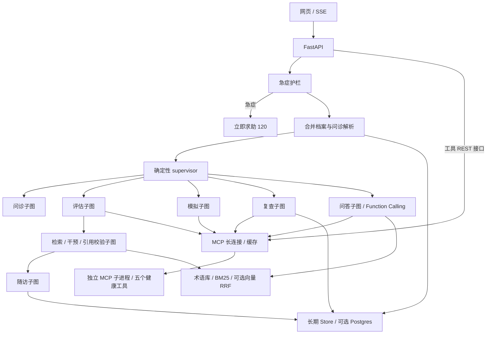

# HealthPilot

心血管健康评估 Agent 技术演示：中文多轮问诊、急症护栏、风险评估、带引用的健康干预、干预模拟与跨会话随访。浅色响应式界面实时展示 Agent 轨迹、工具调用、耗时和指南来源。

| JD 能力 | 实现 |
|---|---|
| 多 Agent 规划与状态管理 | LangGraph 主图与七个职责子图，确定性 supervisor |
| 工具调用与世界模型 | MCP 2.x stdio 五个工具、Function Calling 循环、并行计算与 LRU 缓存 |
| 长短期记忆、PostgreSQL | checkpointer + Store；配置 DATABASE_URL 后启用 Postgres |
| 医学 RAG 与幻觉控制 | 术语归一、BM25 / 向量 RRF、逐条引用和药物剂量校验 |
| Prompt 工程与评测 | 四个版本化提示词、节点轨迹、任务/规划/引用/急症/时延指标 |
| 工程与平台对接 | FastAPI、SSE、OpenAPI 工具接口、Docker 与 GitHub Actions |



需要 Python 3.12+。常规环境运行：

```bash
uv sync
HEALTH_AGENT_MOCK=1 uv run uvicorn app.main:app --port 8000
uv run pytest -q
uv run python -m eval.run_eval --mock
```

访问 http://localhost:8000。已有依赖的离线环境可用 `.venv/bin/python -m pytest -q` 和 `.venv/bin/python -m eval.run_eval --mock`。

真实模式在本地 `.env` 配置 `QWEN_API_KEY`、`QWEN_BASE_URL`、`QWEN_MODEL`，不设置 `HEALTH_AGENT_MOCK=1`，运行 `uv run uvicorn app.main:app --port 8000`。可选 `QWEN_EMBEDDING_MODEL` 启用向量融合；模型失败降级为模板并记录 `degraded: true`，向量失败退回 BM25。`uv run python -m eval.run_eval --judge` 可额外评价交互体验。

可选 `DATABASE_URL` 启用 Postgres checkpointer 与 Store，启动时自动 setup；未配置时记忆仅保留在当前进程。`runs/traces/` 保存逐轮轨迹，`eval/results/` 保存评测 JSON。轨迹含健康信息，仅适合受控演示环境，部署与访问控制见 [部署说明](docs/DEPLOY.md)。`/docs` 提供五个工具的独立请求模型，`/openapi.json` 可导入 Dify / Coze。

“新会话”保留浏览器身份和长期记忆；“清除身份”生成新身份，不删除服务端历史。项目不包含账号认证。真实千问、Postgres 与生产部署需在具备网络及数据库的环境完成验证。

仅为技术演示，不构成医疗建议。语料为公开指南要点摘要，引用通过不等于独立医学事实审查。Framingham 基于美国人群，可能高估中国人群风险，国内推荐 China-PAR；模拟和轨迹不代表个人实际获益或未来结果。急症请立即拨打120。
