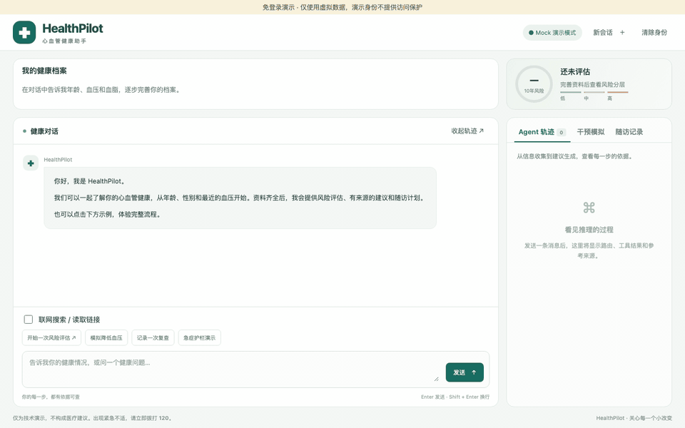
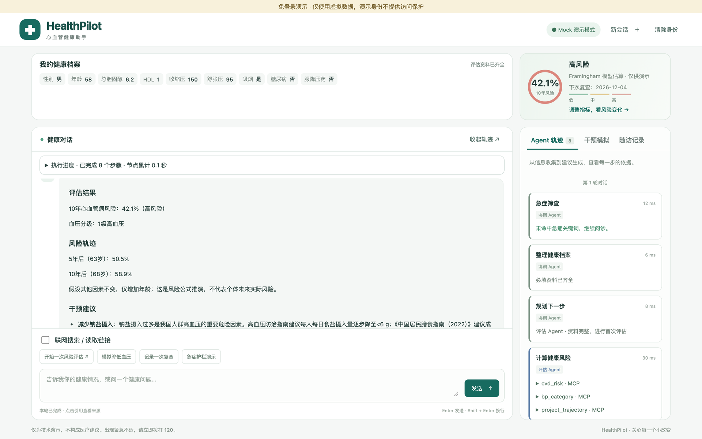
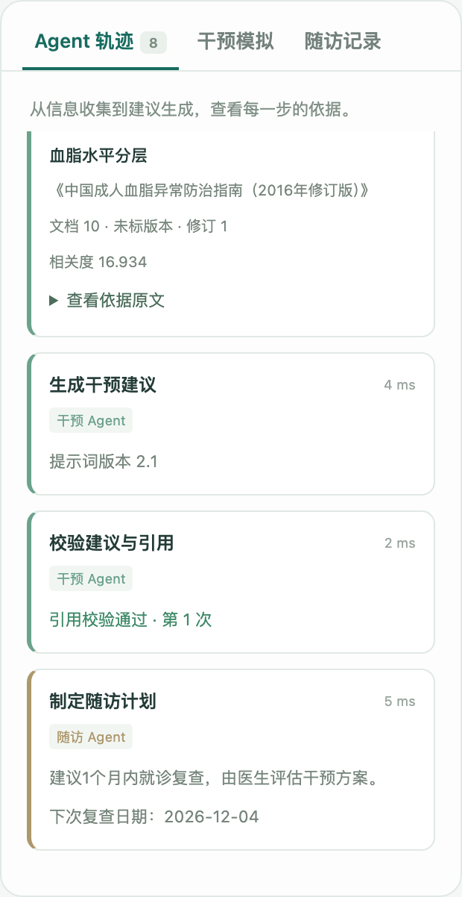
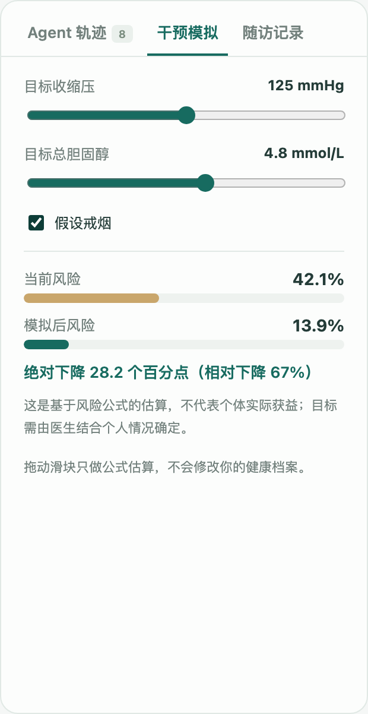
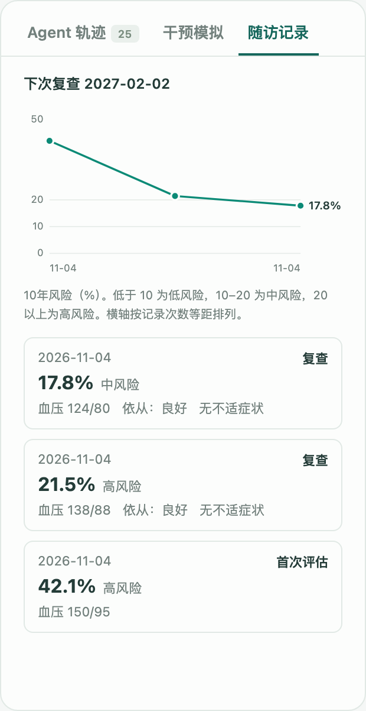
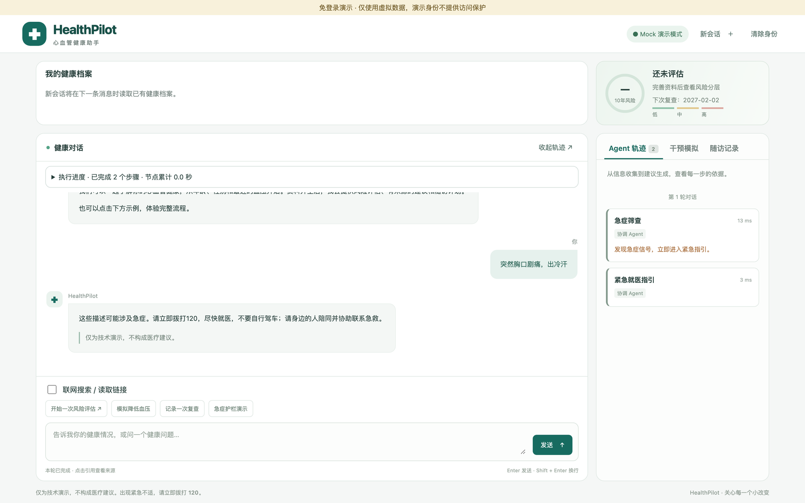
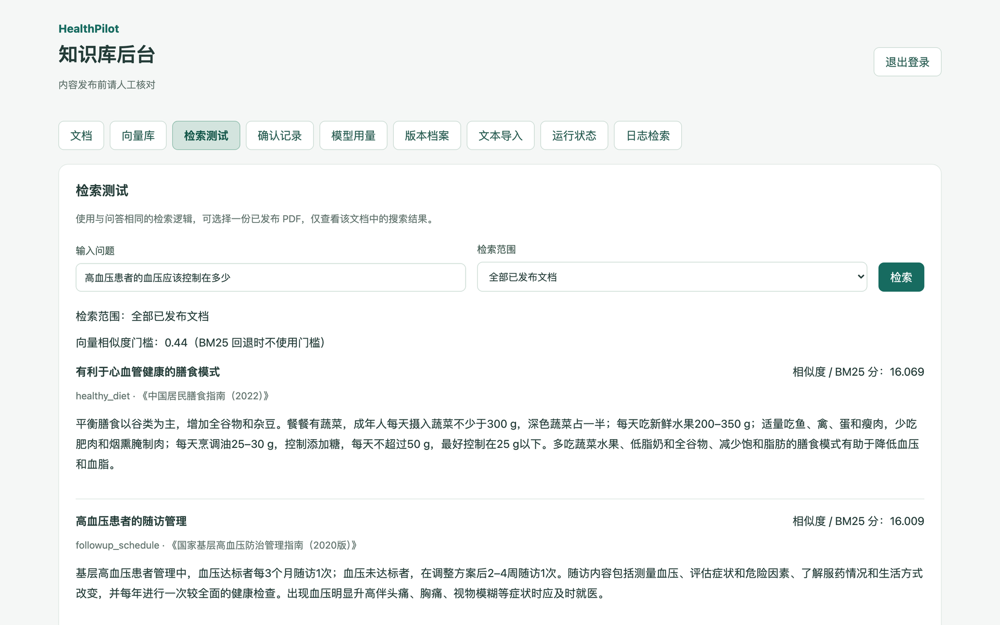

<div align="center">


# HealthPilot

**会追问、会算风险、只按指南说话的心血管健康 Agent**

用中文描述健康情况，它会追问缺失的信息，计算 10 年心血管病风险，<br>
再根据指南给出带引用的生活方式建议，并在之后的复查中追踪风险变化。

[](https://github.com/NewUranus/health-agent/actions/workflows/ci.yml)


[在线演示](https://47-250-192-131.sslip.io) · [30 秒跑起来](#30-秒跑起来) · [架构](#架构) · [评测](#评测) · [接口与运维文档](docs/PLATFORM.md)



</div>

> [!WARNING]
> 这是技术演示，没有经过医学人员审核，不构成医疗建议。在线演示请只填写虚拟数据；出现急症请立即拨打 120。

## 它和普通健康聊天机器人有什么不同

| 设计 | 说明 |
|---|---|
| 🧮 **医疗判断不交给模型** | 流程路由、风险计算、引用校验都是确定性代码。急症以规则为准，模型只能补报、不能撤销。模型只负责抽取信息、急症补漏、撰写建议和回答问题。 |
| 🚫 **没有依据就拒答** | 检索低于相关性门槛时直接拒答；生成后检查引用是否有效、是否出现药物剂量，不通过就重试，仍不通过就拒答。 |
| 🚨 **急症优先** | 每条消息先过急症筛查：关键词规则命中直接判急症；规则没命中时再由模型识别口语、方言等说法，模型给出的依据必须是用户原话。命中后立即给出拨打 120 的指引，复查问诊中途也一样。 |
| 🎚️ **可以推演"如果……会怎样"** | 拖动血压、胆固醇滑块或勾选戒烟，实时看风险变化，并显示 5 年、10 年后的风险。纯公式计算，不调用模型，也不改档案。 |
| 📈 **会随访** | 评估后记下复查日期；复查时多轮询问血压、依从、吸烟和症状，再和历次风险对比画成曲线。 |
| 🔍 **每一步都看得见** | 右侧实时显示每个节点、MCP 工具调用、检索到的指南原文和耗时。 |

## 截图

<table>
  <tr>
    <td colspan="3"><p align="center"><sub>评估结果（左）和 Agent 执行轨迹（右）：风险由 MCP 工具计算，建议附指南引用</sub></p></td>
  </tr>
  <tr>
    <td width="33%"><p align="center"><sub>检索到的指南依据、引用校验结果</sub></p></td>
    <td width="33%"><p align="center"><sub>干预模拟：降压、降脂、戒烟后的风险</sub></p></td>
    <td width="33%"><p align="center"><sub>随访记录：历次复查的风险曲线</sub></p></td>
  </tr>
  <tr>
    <td colspan="3"><p align="center"><sub>急症护栏：命中急症信号后跳过评估，直接给出就医指引</sub></p></td>
  </tr>
  <tr>
    <td colspan="3"><p align="center"><sub>知识库后台：上传指南 PDF、人工核对后发布，可用与问答相同的逻辑试搜</sub></p></td>
  </tr>
</table>

<sub>截图来自本地 Mock 模式（模板回复，不调用模型），数据均为虚拟。</sub>

## 30 秒跑起来

需要 Python 3.12+ 和 [uv](https://docs.astral.sh/uv/)。Mock 模式不需要任何 API Key：

```bash
uv sync
HEALTH_AGENT_MOCK=1 uv run uvicorn app.main:app --port 8000
```

打开 http://localhost:8000 ，点下方的示例按钮就能走完整流程。

- **接真实模型**：在 `.env` 里配置千问的 OpenAI 兼容接口，真实模式默认要求登录，步骤见 [运行说明](docs/PLATFORM.md#运行)
- **Docker 部署**（Postgres、HTTPS、访问口令）：见 [docs/DEPLOY.md](docs/DEPLOY.md)

## 架构


### 技术栈

以下列出项目直接使用的主要框架、库和基础设施。Python 的具体依赖版本以 [pyproject.toml](pyproject.toml) 和 [uv.lock](uv.lock) 为准，前端以 [package.json](frontend/package.json) 和 [package-lock.json](frontend/package-lock.json) 为准。

| 模块 | 框架 / 组件 | 项目中的用途 |
|---|---|---|
| 运行与依赖管理 | Python 3.12+、uv | 后端运行、依赖安装和版本锁定 |
| API 与参数校验 | FastAPI、Pydantic、Uvicorn | V1 HTTP API、请求校验、OpenAPI、ASGI 服务和 SSE 流式响应 |
| Agent 编排 | LangGraph、langchain-core | 主图/子图、节点状态、消息、人工中断和恢复 |
| 模型接入 | langchain-openai、千问 OpenAI 兼容接口 | 对话模型、工具绑定和 Embedding；项目自研网关管理限额、路由、降级与用量 |
| 工具协议 | MCP Python SDK 2.x | stdio 子进程暴露健康计算、网页搜索和读取工具 |
| 检索 | pgvector、rank-bm25、jieba | 向量检索、向量不可用时的 BM25 回退、中文分词 |
| PDF 与上传 | PyMuPDF、python-multipart | PDF 文字提取、页码保留、上传解析；切分规则由项目实现 |
| 网页搜索与读取 | Python 标准库 HTTP/HTML/XML 解析 | 适配 Bing RSS、DuckDuckGo HTML，读取公开网页与文字版 PDF，经 MCP 调用 |
| 业务存储 | PostgreSQL、Psycopg 3 | 账号、任务、会话元数据、知识库、权限、审计与模型用量；包含连接池支持 |
| Agent 状态持久化 | langgraph-checkpoint-postgres、LangGraph Store | PostgreSQL checkpointer 和长期记忆；无数据库时采用内存实现 |
| 本地账号与任务存储 | SQLite（Python 标准库） | 未配置 PostgreSQL 时保存账号、任务等平台元数据；健康记忆仍为内存，持久性边界不同 |
| 前端 | React、React DOM、TypeScript、Vite | 对话、会话工作台、知识库管理与运维界面，构建产物由 FastAPI 托管 |
| 结构化日志 | structlog、Python logging | JSON 序列化、业务上下文、统一关联 ID 和敏感信息过滤 |
| 标准链路与导出 | OpenTelemetry SDK、OTLP HTTP/protobuf exporter、HTTPX/Psycopg instrumentation | 应用 span、跨任务/MCP 上下文传播，以及 HTTP 客户端和 PostgreSQL 自动埋点 |
| 遥测采集与存储 | OpenTelemetry Collector、Loki、Tempo | 持久发送队列、日志集中存储、标准 trace 存储；已提供部署配置，需启动服务后使用 |
| 指标与可视化 | Prometheus、Grafana | 指标采集、告警规则、运行大盘、日志与链路跳转；通知接收方需另行配置 |
| HTTP 客户端与环境配置 | HTTPX、python-dotenv | Loki 查询、模型 SDK 的 HTTP 通信支持及 `.env` 加载 |
| 开发验证 | pytest、Vitest、React Testing Library、jsdom | 后端测试、前端组件测试与浏览器 DOM 模拟；医学评测脚本由项目实现 |
| 部署与 CI | Docker / Docker Compose、Caddy、GitHub Actions | 容器部署、HTTPS 入口和持续集成 |

任务队列与 Worker 调度、账号会话和数据权限、模型网关、知识发布审批，以及急症护栏、风险公式、引用校验和随访规则，均为项目代码实现。PostgreSQL 承担持久任务队列；MCP 是工具通信协议；千问是模型服务，三者与应用框架的职责不同。

### OpenTelemetry 可观测性

日志与链路已在代码中接入 **structlog + OpenTelemetry SDK → OTLP Collector → Loki / Tempo → Grafana**，Prometheus 负责指标采集。后台“日志检索”查询 Loki，支持按请求、任务、脱敏会话/用户标识定位，并跳转 Grafana 查看完整链路。HTTP、队列、Worker、Agent 节点、模型、RAG、MCP 和数据库调用共享标准追踪上下文；健康正文、提示词、SQL、URL 和异常正文不会导出。

这里的“接入”指代码与部署配置已完成，不表示这些服务已经在本机或在线演示部署。默认不向外发送遥测，设置 OTLP 端点后启用导出；Loki 查询还需配置服务地址。新日志不再写入旧 PostgreSQL 日志表，旧数据保留。启动配置与迁移说明见 [OpenTelemetry 部署说明](ops/OBSERVABILITY.md)，当前提供单机持久化方案，未完成高可用、容量或故障恢复验收。

<details>
<summary>目录结构</summary>

| 目录 | 内容 |
|---|---|
| `app/` | FastAPI 接口、状态图、检索、校验、记忆 |
| `mcp_server/` | MCP 工具服务（stdio） |
| `corpus/` | 16 段指南摘要 |
| `frontend/` | 前端源码（React + TypeScript） |
| `web/` | 前端构建结果，由 FastAPI 托管 |
| `eval/` | 评测脚本和用例 |
| `ops/` | 监控、告警、备份和发布脚本 |
| `docs/` | 设计文档、部署与接口说明 |

改前端时在 `frontend/` 下运行 `npm run dev`；改完运行 `npm run build`，并把 `web/` 一起提交。

</details>

## 不只是 Demo：平台能力

账号与数据隔离、持久化任务与幂等、知识发布的人工确认、知识权限与撤回、模型网关与用量统计、多会话工作台、运行状态面板、集中日志与链路检索。

接口、配置项和各阶段的实现说明见 **[docs/PLATFORM.md](docs/PLATFORM.md)**，51 个检查项及验收进度见 [验收矩阵](ACCEPTANCE_MATRIX.md)。

## 评测

```bash
uv run pytest -q
uv run python -m eval.run_eval --mock
cd frontend && npm ci && npm test
```

2026-10-30 用 `qwen3.6-plus` 跑了一次真实模型评测：26 条用例全部通过，每轮响应 p50 约 3.7 秒、p95 约 5.2 秒。

这个结果的参考价值有限：用例是开发时自己写的，数量很少；"医学事实性"一项只检查引用是否有效，不检查内容是否正确。

### 急症分诊

`eval/emergency_cases.jsonl` 有 100 条用例：64 条急症（口语、比喻、方言、错别字、夹杂否定、替家人描述），36 条容易误报的非急症（知识提问、既往病史、明确否认、“笑死我了”一类夸张说法）。

```bash
uv run python -m eval.run_triage_eval          # 真实模型，需要 .env
uv run python -m eval.run_triage_eval --mock   # 只跑规则通道
```

2026-11-07 用 `qwen3.6-plus` 的结果：

| 方案 | 召回率 | 误报率 |
|---|---|---|
| 纯关键词规则 | 6.2%（4/64） | 11.1%（4/36） |
| 规则 + 模型双通道 | 100%（64/64） | 11.1%（4/36） |

模型补上了 60 条规则漏掉的急症，没有新增误报；4 条误报都来自规则（如“呼吸困难的人应该怎么急救？”），按设计模型不能撤销规则结果。规则没命中时每条消息多一次模型调用，实测 p50 约 1.1 秒、p95 约 1.3 秒。原有 `eval/cases.jsonl` 的 12 条急症用例在双通道下结果不变。

参考价值有限：用例和分诊提示词是同一个人写的，可能偏向提示词覆盖的说法；没有医生标注，也没有真实用户的表达。双通道召回率低于纯规则时评测脚本以非零状态退出。

### 检索选型

`eval/run_rag_eval.py` 用 50 道题对比三种检索（语料 16 段，题目是自己写的）：

| 方案 | 首条命中 | 前 3 条命中 |
|---|---|---|
| BM25 | 76.3% | 92.1% |
| BM25 + 向量（RRF 融合） | 84.2% | 94.7% |
| 向量 | 100% | 100% |

所以选了纯向量。语料小、主题差别大，这个 100% 不代表真实效果。

相关性门槛（余弦相似度 0.44）在这批题上调出来，再用没参与调参的 35 道新题（`eval/rag_holdout.jsonl`）验证：21 道可答题中 19 道首条正确且未被误拦；14 道语料答不了的题挡住 10 道。漏过的 4 道都是话题相近但人群不同（如孕妇、透析），要靠提示词让模型说明资料未覆盖，抽查的几道都做到了，但没有做系统统计。

## 已知限制

- **风险模型**：Framingham 基于美国人群，可能高估中国人群风险，国内更适合用 China-PAR。这里还没有实现
- **语料**：内置的只有 16 段摘要，按公开指南要点撰写，没有逐条对照原文，也没有文献和药品说明书
- **幻觉**：校验只查引用是否有效，不查内容是否被资料支持。抽查发现模型拒答时可能补充资料之外的知识
- **PDF 解析**：不支持扫描版；表格解析没有专门处理，发布前要人工核对
- **急症识别**：规则之外的说法靠模型补漏，模型失败或超时（10 秒）时只剩关键词规则；Mock 模式只有规则。分诊评测集是开发者自己写的，没有医生标注，见上文“急症分诊”。纯知识提问（如“胸痛一般是什么原因”）会被规则误报为急症
- **随访**：提醒只在用户打开页面时出现，没有短信或微信推送，也没有医生审核；用药和症状的判断是简单的关键词规则
- **部署**：运行在一台 1G 内存的海外轻量服务器上，用的是临时域名（sslip.io），从中国内地访问的速度和稳定性没有系统测过
- **规模**：只做过单人使用，没有压测。不配置 `DATABASE_URL` 时记忆存在内存里，重启就丢
- **安全**：本地实现了账号、可撤销会话、用户隔离及基础审计，尚无组织、SSO、多角色、完整加密治理或防篡改审计。Mock 免登录模式没有个人数据访问保护，仅用于虚拟数据。代码未部署到在线演示，不能据此判断远端已经启用登录。
- **许可证**：PyMuPDF 是 AGPL，闭源商用需要换库或购买授权

## 更多文档

| 文档 | 内容 |
|---|---|
| [docs/PLATFORM.md](docs/PLATFORM.md) | 运行配置、HTTP API、各阶段平台能力 |
| [docs/DESIGN.md](docs/DESIGN.md) · [DESIGN_V2.md](docs/DESIGN_V2.md) | 设计文档 |
| [docs/DEPLOY.md](docs/DEPLOY.md) | Docker 部署 |
| [docs/ADMIN.md](docs/ADMIN.md) | 知识库后台 |
| [docs/FOLLOWUP.md](docs/FOLLOWUP.md) | 随访流程 |
| [ops/README.md](ops/README.md) | 监控、日志、备份与发布 |
| [ops/OBSERVABILITY.md](ops/OBSERVABILITY.md) | OpenTelemetry、Collector、Loki、Tempo、Grafana 的配置与部署 |
| [ACCEPTANCE_MATRIX.md](ACCEPTANCE_MATRIX.md) | 目标与验收矩阵 |
